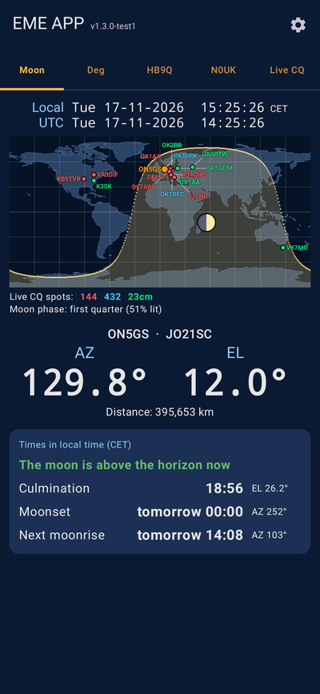
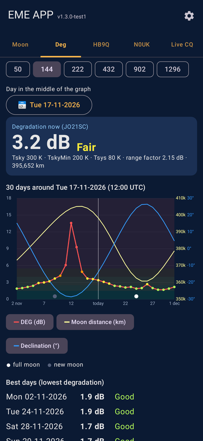
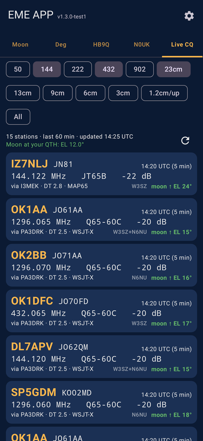
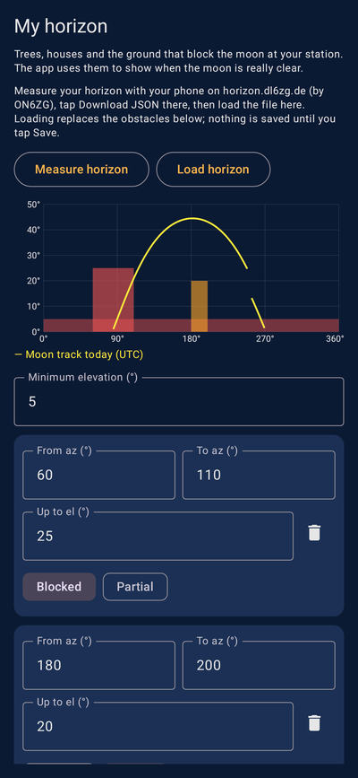

# EME APP (ON5GS)

An Android app for EME (moonbounce) operators, made for ON5GS.

## Download

**[Download the app (EME-APP.apk, latest version)](https://github.com/on5gsdirk-cmd/EME-APP/releases/latest/download/EME-APP.apk)**

Open the link on your Android phone, open the downloaded file and allow installation from this source.
It installs over earlier versions; your settings and HB9Q login are kept.
What changed in each version: [Releases](https://github.com/on5gsdirk-cmd/EME-APP/releases).

## Screenshots

| Moon | Deg | Live CQ | My horizon |
|---|---|---|---|
|  |  |  |  |

## Tabs

| Tab | What it does |
|---|---|
| **Moon** | Moon AZ/EL for your locator (Meeus, topocentric), date and time (local + UTC), moonrise / culmination / moonset, and a world map showing where the moon is above the horizon, the current moon phase and the Live CQ stations in the colour of their band. With an own horizon (see below) it also shows whether the moon is clear of your horizon, and the next window in which it is. |
| **Deg** | EME degradation as calculated by MMMonVHF, per band from 50 to 1296 MHz: the value right now, a 30-day graph around a chosen date with moon distance, declination and full and new moon, a calendar that marks the best days of the month, and the best days of the graph as a list. |
| **HB9Q** | The HB9Q EME chat, **read only** (agreed with HB9Q), per band, with three sub-pages: **Messages**; **QRV**, the stations that wrote recently; and **Chat CQ**, the CQ calls of the last 60 minutes as a table. Includes a "Log out" button. |
| **N0UK** | The N0UK WSJT EME chat (144 MHz), **read only**, with the same three sub-pages: Messages, QRV (with date and time) and Chat CQ (last 60 minutes, with frequency, period, mode, locator and moon elevation; a CQ is greyed out when the station later wrote "stop"). Fetched at most once every 90 s. |
| **Live CQ** | CQ spots from W3SZ Live CQ and N6NU Live CQ together (MAP65/Q65/WSJT-X, CQ calls only), filtered per band, showing where each spot comes from and whether the station has the moon above its horizon. "Moon at your QTH" uses your own horizon when you have one. |

**Settings** (the gear at the top right): callsign, locator, HB9Q login (stored encrypted with the
Android Keystore), language, My horizon, and a link to the release notes of the installed version.

**My horizon** (in Settings): the trees, houses and ground that block the moon at your station.
Enter a minimum elevation and obstacles from azimuth to azimuth, blocked or partial, or measure
them: "Measure horizon" opens horizon.dl6zg.de (by ON6ZG) on your phone, and "Load horizon" turns
the downloaded survey into obstacles. A chart shows your horizon with today's moon track. With the
diameter of your dish and its band, half the beamwidth is added above your horizon, so the edge of
the beam is clear too.

The app has a dark blue theme and 13 languages (NL, FR, EN, DE, ES, IT, PT, SV, DA, FI, RU, ZH, JA).

## Web app (iPhone)

iPhone users cannot install the APK. Open **https://eme.on8ar.eu** in Safari instead. It has the same
screens as the app (Moon, Deg, HB9Q, N0UK, Live CQ, Settings and My horizon), the same calculations and
the same 13 languages. The HB9Q tab needs your own HB9Q login, entered in Settings; the web app keeps it
only in your browser. Live CQ and the N0UK chat are fetched once for all web users together, at the same
intervals as the app.

To keep it on your home screen, tap the share button in Safari and choose "Add to Home Screen".

## Building

Requirements: Android Studio (or JDK 17+ and the Android SDK, platform 35).

```bash
./gradlew assembleDebug        # app/build/outputs/apk/debug/app-debug.apk
./gradlew testDebugUnitTest    # unit tests
./gradlew testDebugUnitTest -Pscreenshots   # also renders screenshots into app/build/screenshots/
```

The web app needs Node 24 and Go (the version in `web/server/go.mod`):

```bash
(cd web && npm ci && npm test)    # web app tests
(cd web && npm run build)         # web/dist/
(cd web/server && go test ./...)  # web server tests
```

The screenshots above are `moon.png`, `livecq.png`, `readme-deg.png` and `readme-horizon.png` from
`app/build/screenshots/`, scaled to 400 px wide.

## Project layout

```
app/src/main/java/be/on5gs/eme/
  moon/          moon position (Meeus), rise/set, moon phase, world map, label placement
  degradation/   degradation (MMMonVHF method) and the Deg screen
  location/      Maidenhead locator <-> latitude/longitude
  cq/            Live CQ from W3SZ (CSV export) and N6NU (JSON), band colours
  chat/          HB9Q chat (read only), Chat CQ parsing
  n0uk/          N0UK chat (read only), its CQ parsing
  horizon/       own horizon, horizon survey import, moon windows, My horizon screen
  settings/      settings, encrypted login, language selection
  ui/theme/      theme
app/src/main/res/values*/strings.xml   translations
app/src/main/assets/land110m.txt       coastlines for the world map
app/src/test/                          unit tests, layout test, screenshot test
web/src/        the web app (plain JavaScript, Vite): lib/ has the ports of the calculations and parsers
web/server/     Go server: serves the web app, fetches W3SZ, N6NU and N0UK for all users, HB9Q per user
web/deploy/     systemd units, nginx config and the update scripts for eme.on8ar.eu
docs/releases/  release notes per version
.github/        unit tests on every pull request, and the release workflow
```

## Sources and credits

- Moon calculations: Jean Meeus, *Astronomical Algorithms* (chapters 12, 22, 25, 40, 47, 48); tested against astropy.
- Degradation and the 144 MHz sky temperature table: MMMonVHF (www.mmmonvhf.de/eme.php), based on the EME Handbook 2010 / WSJT data by K1JT.
- Live CQ: W3SZ (w3sz.com/livecq.html), via its official CSV export.
- Live CQ: N6NU (livecq.n6nu.org), via the JSON its own page uses — read only.
- HB9Q EME chat: logger.hb9q.ch — read only, in agreement with HB9Q.
- N0UK WSJT EME chat: www.chris.org/cgi-bin/jt65emeA — read only.
- Horizon survey: horizon.dl6zg.de by ON6ZG.
- Coastlines: Natural Earth 1:110m (public domain), via world-atlas (ISC, © Mike Bostock).

The test data in `app/src/test/resources/` are real samples from the HB9Q chat, the N0UK chat,
W3SZ Live CQ and N6NU Live CQ, used to test the parsers. All e-mail addresses in them have been replaced by `xxxx@test.com`.

## License

The code in this repository (`app/` and `web/`) is licensed under the GNU General Public License
v3.0, see [`LICENSE`](LICENSE). The license covers the code only: the data from HB9Q, W3SZ, N6NU
and N0UK is not ours to license, and the rules for those services are in `CONTRIBUTING.md`.
